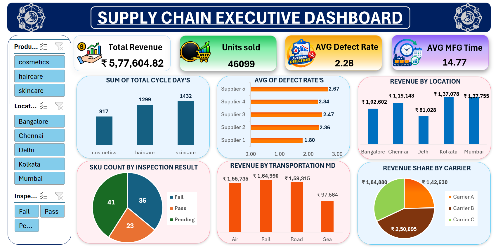

# Cosmetic Data Analysis – Excel Dashboard

## Project Overview
This project is an interactive Excel Dashboard created to analyze cosmetic business data and generate meaningful business insights.

## Tools Used
- Microsoft Excel
- Pivot Tables
- Pivot Charts
- Slicers
- Excel Formulas

## Workbook Sheets
1. Row Data
2. Pivot Engine
3. Dashboard
4. KPI

## Key Features
- Interactive Excel Dashboard
- KPI Tracking
- Data Analysis
- Data Visualization
- Business Performance Insights

## Skills Demonstrated
- Data Cleaning
- Data Analysis
- Data Visualization
- Dashboard Creation

## Project File
Download the Excel workbook from this repository to explore the dashboard.
## Dashboard Preview

